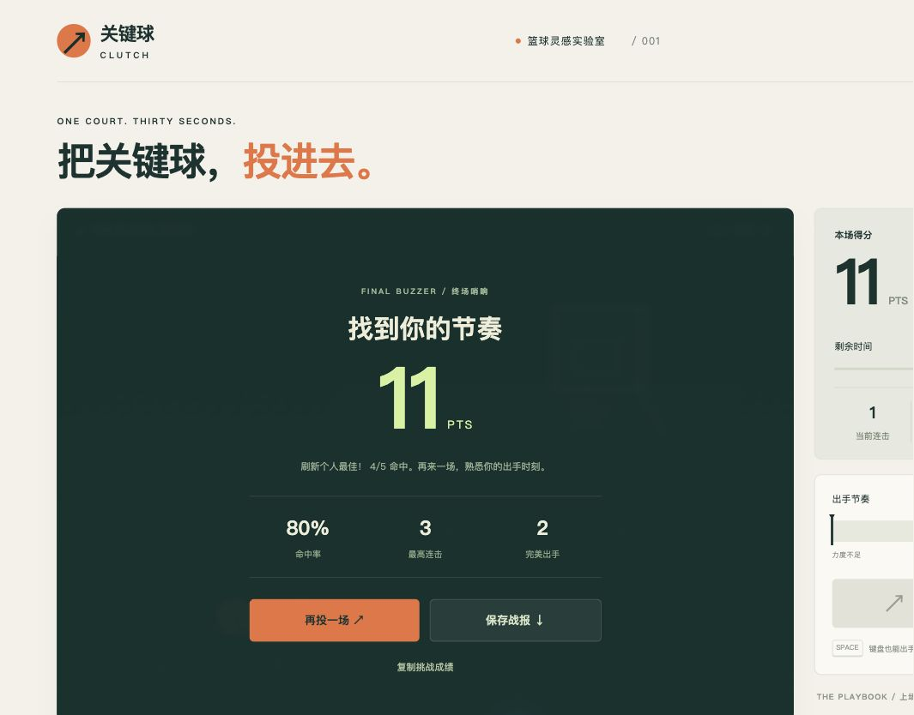

# 关键球 CLUTCH · 30秒投篮挑战

一个围绕出手节奏、连击奖励与短局重玩的篮球网页小游戏。个人练习作品，使用 Codex 辅助开发。



## 玩法

1. 点击「开始挑战」。
2. 按住出手按钮或空格蓄力，在绿色区域松手出球。
3. 普通命中 +2 分、完美出手 +3 分；3连中起，每球额外 +1 分。
4. 每命中3球改变力度目标，并加快蓄力节奏。30秒结束后生成成绩卡。

## 已完成功能

- Canvas 2D 球场、篮球飞行动画、入网与粒子反馈。
- 基于出手力度的确定性命中判定，普通/完美命中、连击及递增难度。
- 30秒倒计时、暂停/恢复、页面失焦自动暂停、末秒已出手篮球结算。
- 本地个人最佳、命中率、最高连击、完美出手统计。
- 可切换合成音效、PNG战报下载、成绩文本复制。
- 桌面键盘与触屏按钮输入，响应式布局。

## 本地运行

无需安装前端依赖。下载仓库后，在仓库目录运行：

```bash
python3 -m http.server 8765
```

浏览器打开 http://localhost:8765 。也可运行 `npm start`。

使用 Node.js 运行核心逻辑测试：

```bash
npm test
```

## 技术与设计

原生 HTML、CSS、JavaScript ES Modules、Canvas 2D、Web Audio API 和 localStorage；不依赖外部素材、付费接口或后端。

玩法聚焦于「蓄力—判断时机—出手—结果反馈」循环，通过完美出手、连击奖励和难度变化提供继续挑战的动机。球的运动使用曲线动画展示，不是完整的刚体物理模拟。

核心计分、连击、命中窗口与蓄力周期通过自动测试；已进行浏览器投篮、暂停、终场结算及战报生成检查。

## 文件说明

| 文件 | 用途 |
| --- | --- |
| index.html | 页面结构 |
| style.css | 视觉与响应式布局 |
| game.js | 输入、动画、计时、音效与战报 |
| engine.js | 命中判定、难度与计分逻辑 |
| engine.test.js | 核心逻辑测试 |

## 后续迭代方向

基于真实试玩反馈调整力度窗口、难度曲线与短局节奏；验证完局率、重玩率、分享率。目前没有收集玩家行为或运营数据，也没有在线排行榜。个人最佳仅保存在当前浏览器。

作者：徐烁。个人练习作品，与虎扑或任何职业联赛无隶属关系。
